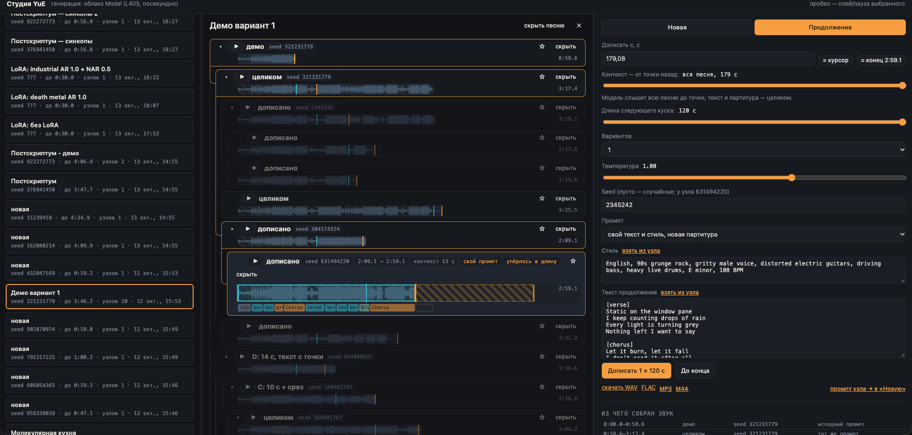
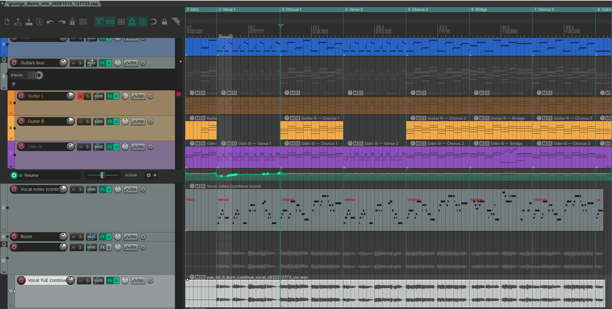

# Рок демка с нуля, часть 2: вокал. Claude + REAPER + YuE2

В [прошлой статье](../reaper-claude/) я делал инструментальную композицию с помощью Claude и REAPER и сводил её. Сегодня пойдём дальше — добавим вокал. Для этого я подключил нейросеть YuE2: локально на маке и в облаке на Modal.

Идея такая. YuE2 сама пишет партитуру песни, а потом по ней генерирует звук. Но формат партитуры открытый: можно написать свою и скормить модели только для генерации звука. А у нас уже есть партии баса и гитары, которые написал Claude. Вот пусть он и напишет к ним вокальную партию.

## Связка инструментов

| Звено | Что делает |
|---|---|
| **Claude Code** | смотрит бас и гитары в проекте, сочиняет мелодию вокала, пишет партитуру и промпт, проверяет результат замерами |
| **REAPER** | проект из прошлой статьи; ноты вокала ложатся туда MIDI-дорожкой с пианино — послушать и поправить руками |
| **YuE2-3B** | генерация песни по тексту, стилю и партитуре ([GitHub](https://github.com/multimodal-art-projection/YuE), [обзор на русском](https://neurohive.io/ru/papers/yue2-nejroset-dlya-sozdaniya-pesen/)) |
| **Modal** | облако с GPU, YuE2 крутится там на L40S 48 ГБ |
| **Студия YuE** | мой локальный веб-интерфейс к генерации |
| **UVR (BS-Roformer)** | достаёт голос из сгенерированной песни |
| **Скилл `yue-score`** | записанный порядок действий: от стихов до дорожки в REAPER |

## Где крутится YuE2

Локально YuE2 работает и на маке, но медленно: минута-полторы песни генерируется около 10 минут. Поэтому я завёл её на [Modal](https://modal.com) — это облако, где платишь посекундно только за время работы GPU. Код деплоится из Python одной командой, контейнер с моделью сам поднимается на запрос и сам засыпает. На бесплатном тарифе дают 30 долларов в месяц — для экспериментов хватает с запасом. У меня там видеокарта L40S на 48 ГБ.

Сверху я навайбкодил с помощью Claude студию — веб-морду для генерации. Идея как у Udio, со всеми плюшками:

- **короткие демо** — сначала генерируешь кусок на 30–60 секунд, а не всю песню сразу, экономишь время GPU;
- **ветвление** — песня растёт деревом: любой кусок можно дописать с любого места, послушать все ветки и выбрать лучшую;
- **смена промпта по пути** — продолжение можно делать с тем же или новым текстом и стилем, с той же партитурой или новой;
- **лучше для контекста** — песня дописывается кусками, и модель не деградирует к концу песни.

Ещё можно скормить свою партитуру, сгенерировать сразу целиком и скачать в MP3/M4A.



## Партитура YuE2

Партитура YuE2 — это текстовый нотный формат ABC: ноты, длительности, аккорды над голосом, секции. Например, первые такты припева «Let it burn, let it fall»:

```
% chorus
V: Vocal
"Em"z2G2A2B8z2|"C"z2G2A2e8z2|"G"zBd2zd3B2z2A4|"D"A2F8z6|
```

У формата свой диалект: только определённые длительности, без триолей и форшлагов, фразы группами по 4 такта, мужской голос записан октавой выше, чем звучит. Всё это Claude выяснил по партитурам, которые пишет сама YuE2, и по официальному справочнику, а потом записал в скилл.

Сама YuE2 пишет довольно квадратно: 4/4, простенькие ритмы. А мне хотелось сложной, интересной мелодики — со сломанными синкопами, сменой размера. Для этого я и дописал скилл.

## Как это работает

| Шаг | Кто | Что происходит |
|---|---|---|
| 1. стихи и задача | я | текст песни, к какому проекту, что хочу от мелодии |
| 2. гармония | Claude | читает из проекта REAPER ноты баса **и** гитар по тактам |
| 3. мелодия | Claude | сочиняет вокал так, чтобы он обыгрывал бас, а не спорил с ним |
| 4. проверка | Claude | валидатор диалекта YuE + интервалы к каждой звучащей ноте баса и гитар; жёстких (малая секунда, тритон, большая септима) на длинных нотах — ноль |
| 5. ноты в REAPER | Claude | мелодия ложится MIDI-дорожкой с пианино, строки текста — подписями, секции — маркерами |
| 6. правка | я | слушаю с группой, двигаю ноты в MIDI-редакторе |
| 7. обратно в партитуру | Claude | забирает правленые ноты из REAPER и переписывает партитуру: аккорды и секции на месте, лиги и знаки расставлены, подсказывает, где поменялось число нот и надо поправить слоги |
| 8. генерация | Claude | партитура + текст + стиль уходят на мой сервер генерации → Modal |
| 9. голос отдельно | Claude | UVR (или Demucs — по усмотрению), при желании ещё чистка от эха отдельным шагом |
| 10. в проект | Claude | голос ложится аудиодорожкой в REAPER ровно под сетку |

Приёмы, которыми Claude «обыгрывает» бас, тоже записаны в скилл:

| Приём | Пример |
|---|---|
| вопрос-ответ | голос поёт, пока бас стоит, и молчит, когда бас ходит |
| длинные ноты — терция или квинта аккорда, не тоника | «burn» — си над ми, «fall» — ми над до |
| вводный тон в конце фразы | ре-диез над си → разрешение в ми в начале следующей |
| предъём | слог перед тактом — уже нотой следующего аккорда |
| кульминация | верх диапазона на сильном аккорде припева: «break» — соль |



## Что получилось

Сначала Claude сгенерировал кусок в 45 секунд: вступление, куплет, припев. Мне он понравился больше всего, хотя был без паузы перед входом в куплет. Тогда Claude взял его за основу: партитура продолжения начинается с тех же 20 тактов слово в слово, дальше второй куплет, припев, бридж, припев и концовка. Модель дописала песню, слыша свой же кусок, — так голос и звук не меняются на стыке.

| Что | Итог |
|---|---|
| длина | 118 с при партитуре на 120 с — модель идёт по ней и заканчивает сама |
| темп | держит 108 bpm, к концу не уплывает |
| входы секций | на 0.2–0.5 с раньше партитуры, ошибка не накапливается: куплет 2 — 44.3 с вместо 44.7, бридж — 80.9 вместо 81.1 |
| высота нот (на прошлой пробе) | точно в ноту — 48%, ±полутон — 60%; тональность в среднем точная (−0.02 полутона) |
| ритм нот (на прошлой пробе) | 64% атак в пределах ±150 мс от партитуры |
| UVR против Demucs | UVR чище: группа протекает в голос на 81 дБ ниже голоса против 49 у Demucs |

Вокал в плеере ниже просто подмешан к мастеру из прошлой статьи — без сведения, без эквалайзера и компрессии.

## Что не получилось

Чистая а капелла не выходит. Без аккордов модель теряет сетку, а с аккордами всё равно играет группа. Зато «а капелла» у YuE звучит как джаз/фанк с **битбоксом** вместо барабанов — это можно брать как отдельный приём.

Да, пока есть косяки и со звуком, и с вписыванием: голос местами съезжает с нот, YuE поёт чуть раньше сетки, сам голос с призвуками генерации. Но это даёт прям хорошие возможности по управлению. Можно управлять каждой ноткой, каждой длительностью, менять голоса в партитуре, менять стиль пения — и прочее. Можно взять готовую MIDI-партию, например бас, и дописать к ней мелодию.

## От автора

На универсальность не претендую — просто показываю свои эксперименты. Может, кому-то пригодится.

PS. Собираюсь завести Boosty и снять ролики по своим изысканиям, а ещё выложить свои скиллы и скрипты для подписчиков. Будет ли вам такое интересно? Пишите.

Если интересно — подписывайтесь, я тут пощу всякое:

- Telegram: [Отряд Котовскага](https://t.me/otryadKotovskaga)
- VK: [vk.ru/otryad_kotovskaga](https://vk.ru/otryad_kotovskaga)
